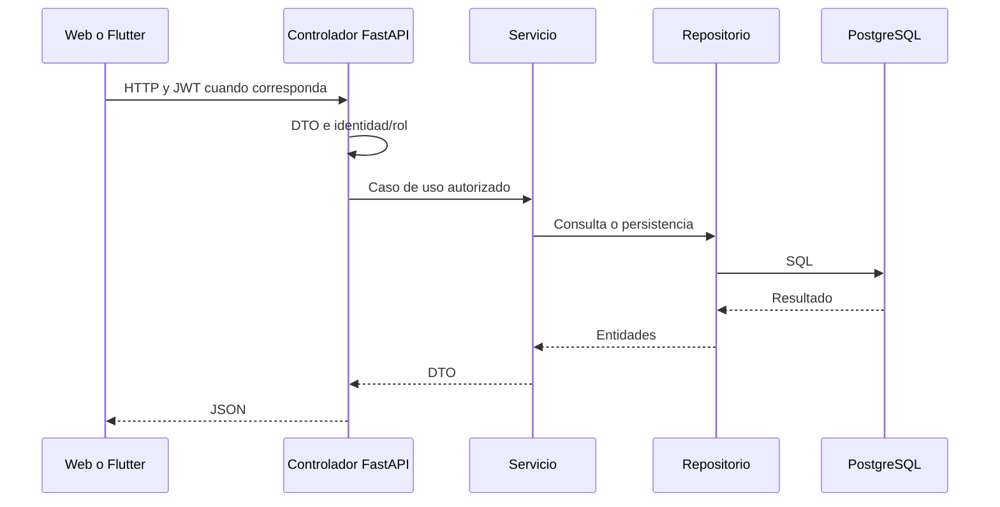

# Directorios y flujos

[Índice](README.md)

| Directorio/archivo | Responsabilidad y extensión |
| --- | --- |
| `main.py` | Composición HTTP, lifecycle y metadatos |
| `app/core/config.py` | `.env` del backend y URL PostgreSQL |
| `app/core/database.py` | Motor, sesiones, UUID y comprobación de arranque |
| `app/core/security.py` | bcrypt, JWT, identidad y roles |
| `app/auth/` | CU-01/CU-02: cuenta, sesión, perfil |
| `app/experience/` | CU-03/CU-04: sedes, categorías, eventos y catálogo |
| `app/booking/` | Reservas, Stripe, conciliación, QR e ingresos; SaaS condicionado |
| `app/matching/` | Agrupación, disponibilidad, búsquedas y demanda observada |
| `app/notifications/` | Avisos persistentes propios y deduplicación transaccional |
| `app/live/` | Contratos de funcionalidades de sprints posteriores |
| `alembic/` | Revisiones del esquema PostgreSQL |
| `scripts/check_database.py` | Inspección de solo lectura mediante psql |
| `tests/` | Regresión de configuración/arranque; ampliar por caso de uso |

Para modificar un contrato: revisar DTO → servicio/controlador → modelos/servicios Angular y Flutter → pruebas de ambos consumidores. Para dinero o capacidad, añadir migración y probar transacciones reales. No importar implementaciones de un cliente dentro del servidor ni copiar entidades ORM como contrato de transporte.
